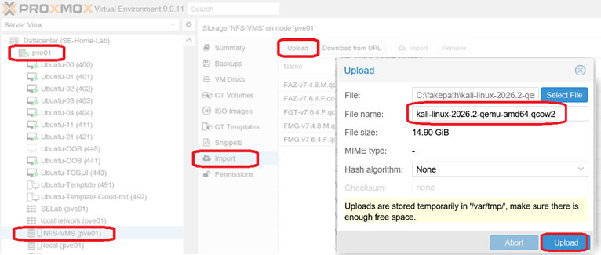
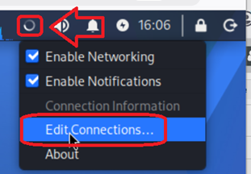
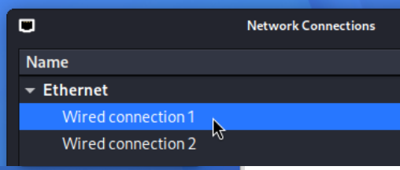
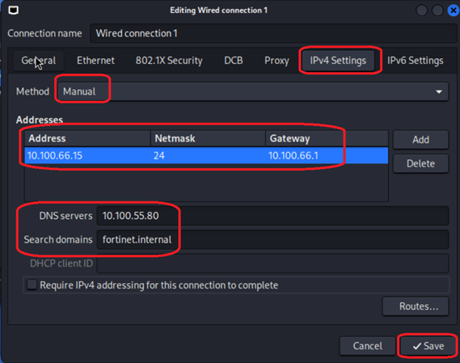
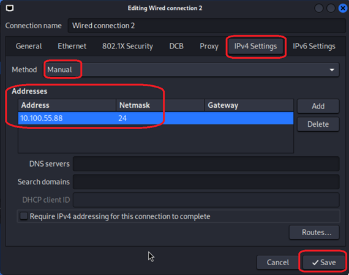

+++
title = "Kali"
type = "default"
weight = 55
+++

- {}This page is a work in progress{}

### **Download Kali ISO**
- Kali Pre-Built VMs - [QEMU](https://www.kali.org/get-kali/#kali-virtual-machines)
- Download and unzip
- Import the Kali qcow2 file


### **Create Kali VM**
- If you get the error {}No route to host{} with any of the following steps, use the **[Troubleshoot Ansible](/Extras/Troubleshoot_Ansible)** steps

{}
- from Terminal in OOB
````bash
cd /home/fortinet/automation/ansible/ubuntu
````
````bash
./create_kali.sh      ../vars/all-hosts.yml  <PVE server name>  kali  <qcow2 file name>
````
````bash
./start_stop_remove_vm.sh  ../vars/all-hosts.yml  <PVE server name>  kali started
````
{}

### **Configure Kali NICs**
{}
Login
    - Default Username/Password : kali/kali
- In upper right corner of desktop, right-click on Network Settings and Edit Connections
    
- Double Click into each Wired connection
    
- Configure Wired connection 1
    - IPv4/Manual/Address/Netmask/Gateway/DNS/Domain
    
- Configure Wired connection 2
    - IPv4/Manual/Address/Netmask
    
{}

### **Configure Kali RDP**
{}
- Update package list: 
````bash
sudo apt update && sudo apt upgrade -y
````
- Install Xfce and XRDP: 
````bash
sudo apt install -y xfce4 xfce4-goodies xrdp
````
- Set Xfce as your default session: 
````bash
echo xfce4-session > ~/.xsession
````

Service configuration
- Enable and start the XRDP service: 
````bash
sudo systemctl enable --now xrdp
````
- Restart the service to apply changes: 
````bash
sudo systemctl restart xrdp
````
- Check the service status to verify it is running: 
````bash
sudo systemctl status
````
{}