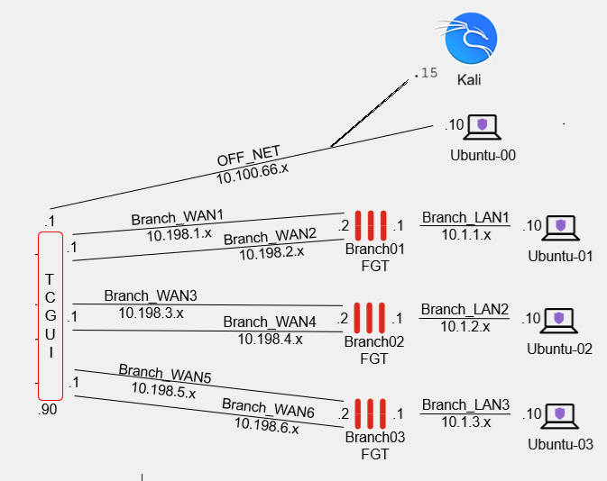
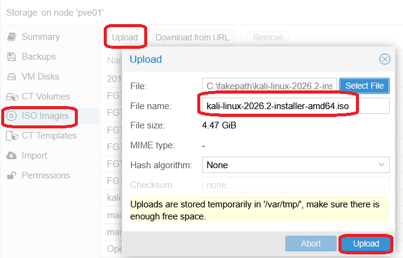
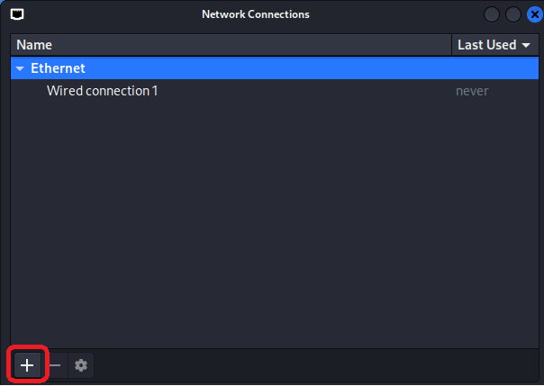
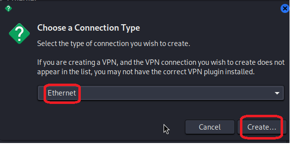
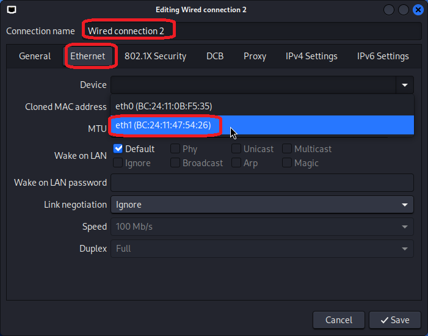
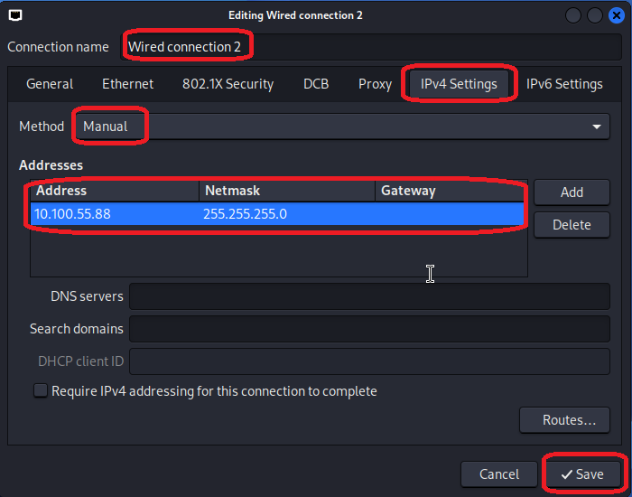
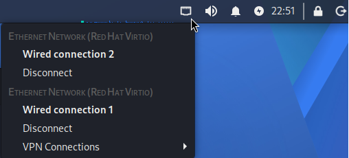

+++
title = "Kali"
type = "default"
weight = 55
+++

### **Assumptions**
- [TCGUI](steps/tcgui) is built and running
- Kali Lab Topology Location
    - The installation steps below, creates a Kali VM in the following location in the lab

| NIC | VNET | IP Address |
| :---: | :---: | :---: |
| eth0 | OFFNET | 10.100.66.88 |
| eth1 | FTNTMGMT | 10.100.55.88 |



### **Download and Import ISO**
- Kali Installer Image - [ISO](https://www.kali.org/get-kali/#kali-installer-images)
- Import the Kali ISO file


### **Create Kali VM**
- If you get the error {}No route to host{} with any of the following steps, use the **[Troubleshoot Ansible](/Extras/Troubleshoot_Ansible)** steps

{}
- from Terminal in OOB
````bash
cd /home/fortinet/automation/ansible/ubuntu
````
````bash
./create_kali.sh      ../vars/all-hosts.yml  <PVE server name>  kali  <ISO file name (no extension..just file name)>
````
````bash
./start_stop_remove_vm.sh  ../vars/all-hosts.yml  <PVE server name>  kali started
````
{}

### **Kali Installer**
{}
- Kali Linux installer menu
    - Choose **Graphical install**
    - Select **Language, Location, Keyboard**
    - Primary NIC used for installation **eth0**
    - Not using DHCP **Continue**
    - **Do not configure** the network at this time
    - Hostname **kali**
    - Username **kali**
    - Password **kali** (not recommended for production, this is for non-internet facing lab)
    - Choose **Time zone**
    - Partition disks 
        - **Guided - use entire disk**
        - **sda**
        - **All files in one partition**
        - **Finish partitioning and write changes to disk**
        - Write the changes to disks? **Yes**
    - Software selection
        - Desktop environment: **Xfce**
        - Collection of tools: **top10** and **default**
    - Install the GRUB boot loader: **Yes**
    - Device for boot loader location: **/dev/sda**
    - Installation complete **Continue**
    - VM reboots
{}

### **NIC Configuration**
{}
- Login
    - Username/Password : **kali/kali**
- In upper right corner of desktop, right-click on Network Settings and Edit Connections
    
- Double Click on **Wired connection 1**

- Configure **Wired connection 1**
    - Ethernet / eth0 
    
    - IPv4 Settings/Manual/Address/Netmask/Gateway/DNS/Search domains
    - Click **Save**
    
- Click on **+**
    
- Choose a Connection Type **Ethernet** and Click on **Create**
    
- Configure **Wired connection 2**
    - Ethernet / eth1 
    
    - IPv4 Settings/Manual/Address/Netmask (Leave Gateway Blank)
    - Click **Save**
    
- In upper right corner of desktop, right-click on Network Settings and see the following
    

{}

### **Configure RDP**
{}
- Update package list: 
````bash
sudo apt update && sudo apt upgrade -y
````
- Install XRDP: 
````bash
sudo apt install -y xrdp
````
- Enable XRDP service: 
````bash
sudo systemctl enable xrdp
````
- Start the service 
````bash
sudo systemctl start xrdp
````
- Check the service status to verify it is running: 
````bash
sudo systemctl status xrdp
````
- Logout and RDP to Kali VM (10.100.55.88)
    - {}You must be logged out of the xfce desktop to successfully RDP to Kali{}

{}

### **Complete**

