+++
title = "Ansible Prerequisites"
type = "default"
weight = 30
+++

### Create FortiFlex API Profile and User

{}
**Create API User and Download Credentials**
- The screenshots in this section, follow the latest FortiFlex documentation found here:
    - [Docs Fortinet](https://docs.fortinet.com/product/flex-vm/26.2)
    - Admin Guide 
        - main section "**Automation/FortiFlex API**
        - sub section: **"To create an API User"**
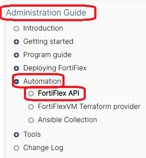
    
- From your FortiCloud support account:
     - https://support.fortinet.com

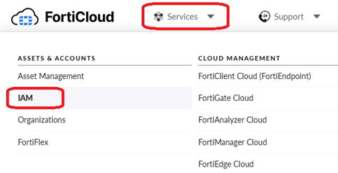

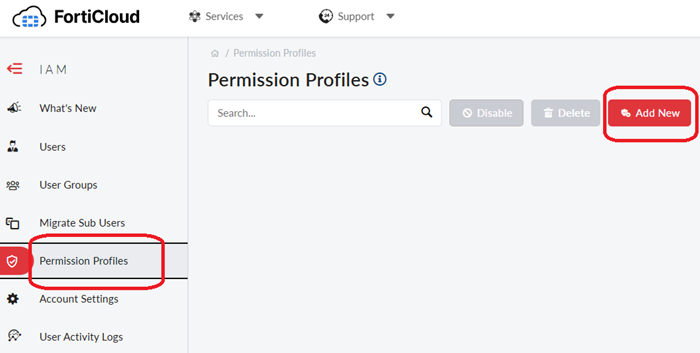

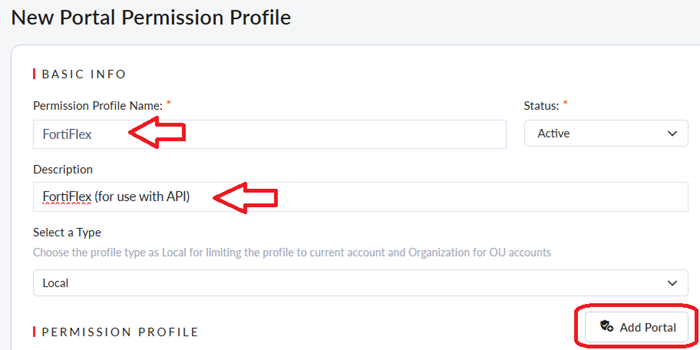

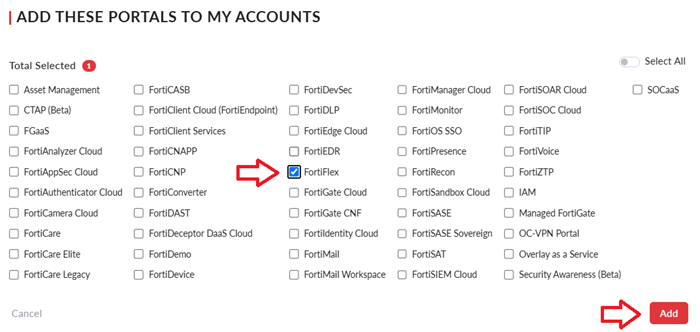

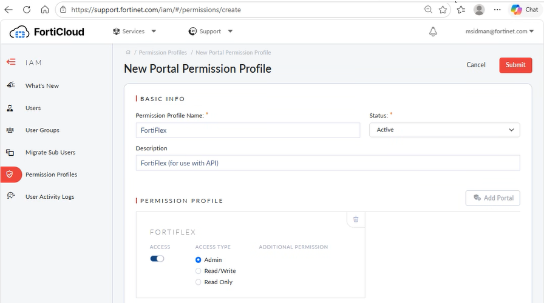

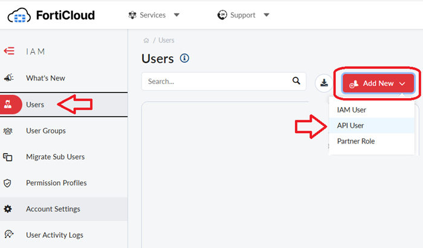

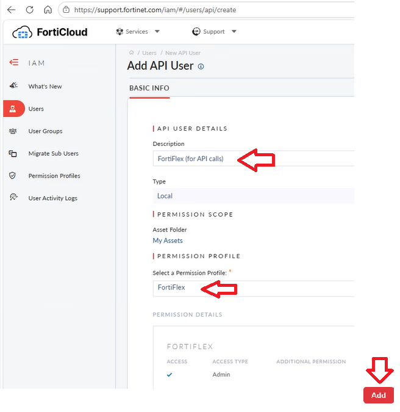

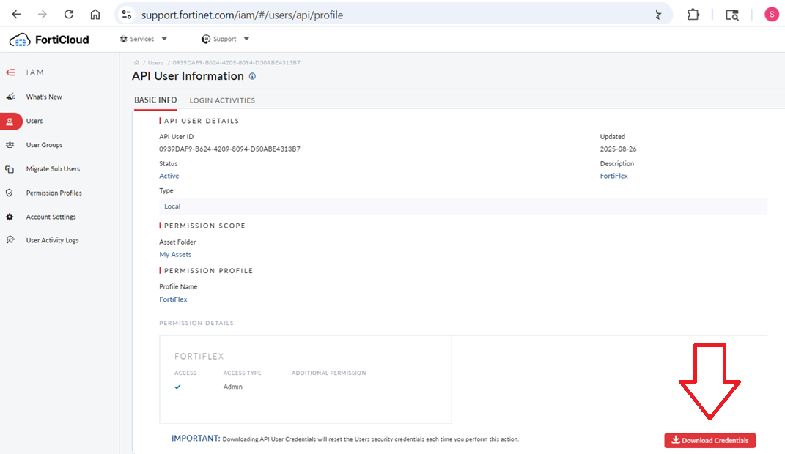
{}


### Create VM Configuration
{}
- The screenshots in this section, follow the latest FortiFlex documentation found here:
    - [Docs Fortinet](https://docs.fortinet.com/product/flex-vm/26.2)
    - Admin Guide 
    - Main section "**Creating a VM configuration**
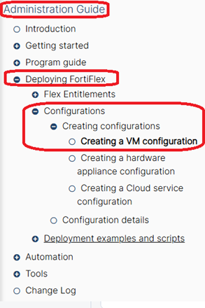
- {}Use a consistent naming convention, especially when running multiple lab environments{}
- {}Example below shows Enterprise bundle, but your lab could use UTP or ATP in addition to possibly having OT security services{}
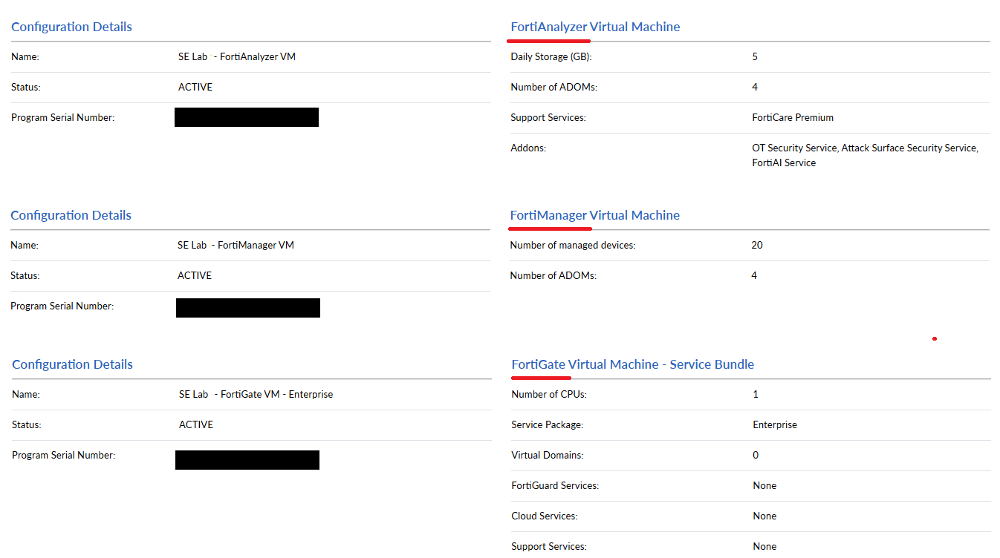
{}

### Create VM entitlements
{}
- The screenshots in this section, follow the latest FortiFlex documentation found here:
    - [Docs Fortinet](https://docs.fortinet.com/product/flex-vm/26.2)
    - Admin Guide 
    - Main section "**Creating VM entitlements**
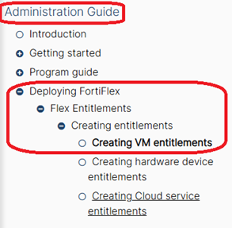

- {}Description **MUST match exactly** (upper/lower case and dashes) as outlined in red in the example below as the automation scrips key off the exact names listed below{} 
- {}While possible to use a pool of entitlements and have Ansible return the first available (i.e. unassigned) token by configuration id.  However, that is beyond the scope of this how-to build document and left to the reader to investigate and implement.{}

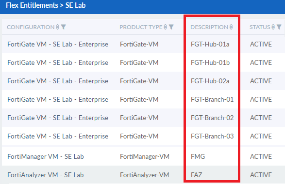
{}


### Create SSH Key on OOB
{}
- Generate SSH Key on Ubuntu-OOB
````bash
cd ~/.ssh
````
````bash
ssh-keygen -t ed25519
````

 - File 	  =>  `/home/fortinet/.ssh/ansible_key`
 - Passphrase =>  <none> just hit enter twice

{} 

{}
-	Place public key on Proxmox

````bash
ssh-copy-id -i /home/fortinet/.ssh/ansible_key root@<your pve server name>
````

- Prompted with the following, respond “yes”
````bash
The authenticity of host 'pve01 (172.16.3.121)' can't be established.
This key is not known by any other names.
Are you sure you want to continue connecting (yes/no/[fingerprint])? yes
````
- Prompted for <your pve server name> password
    - < enter password >
- Verify ability to ssh from Ubuntu-OOB to each PVE server in the cluster without a password
    - **Note:** The first time only, you will be prompted similar to sequence above
````bash
ssh root@<your pve server name 01>
````
````bash
ssh root@<your pve server name 02>
````
{} 

{}
- Update Ansible global.vars file
````bash
cat /home/fortinet/.ssh/ansible_key.pub
````
- Highlight, Right Click and Copy ansible_key.pub contents
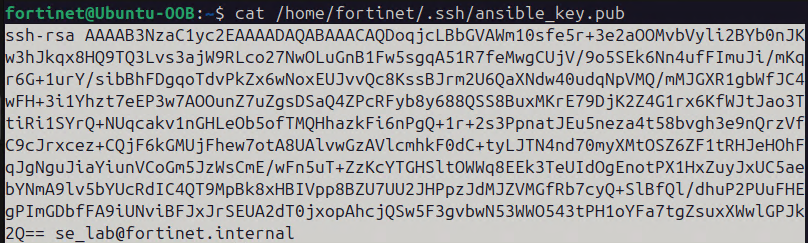
````bash
cd /home/fortinet/automation/ansible/vars
````
````bash
./update_sshkey.sh '<right click - paste SSH KEY here>' (make sure single quotes)
````
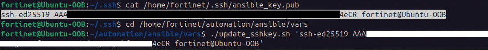
{} 


### Create Ansible API Token on Proxmox Server
{}
- On PVE Server => create Automation User and API Token (with full Administrator access)
    - Click on: Datacenter/Permissions/Groups
        - Click on Create button	
        - Name:	`IaC-admin-users`
        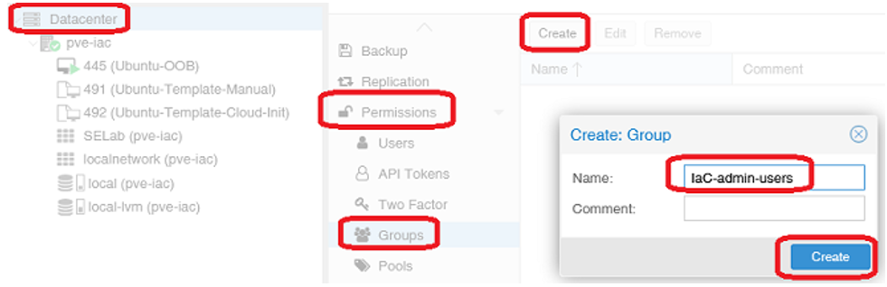
    - Click on: Datacenter/Permissions
        - Click: Add => Group Permission
            - Path: 	/
            - Group:	IaC-admin-users
            - Role: 	Administrator
            - Propagate: 	Checked
        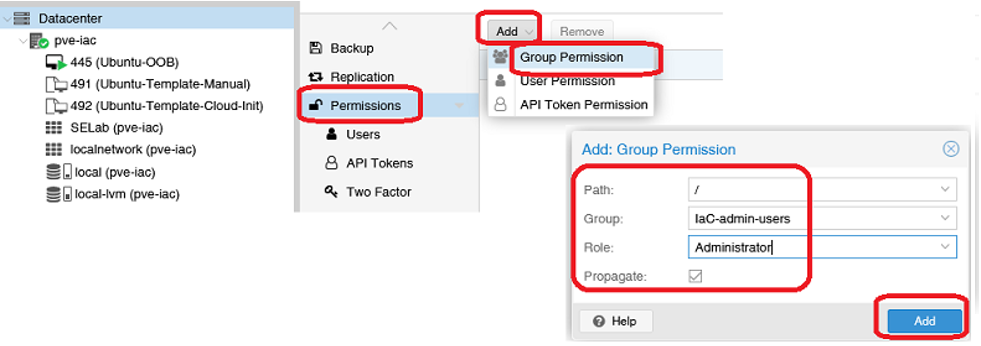
    - Click on: Datacenter/Permissions/Users
        - Click: Add
            - User name: 	`IaC`
            - Realm: 	Linux PAM standard authentication
            - Group:	IaC-admin-users
            - Expires:	never
            - Enabled:	checked
        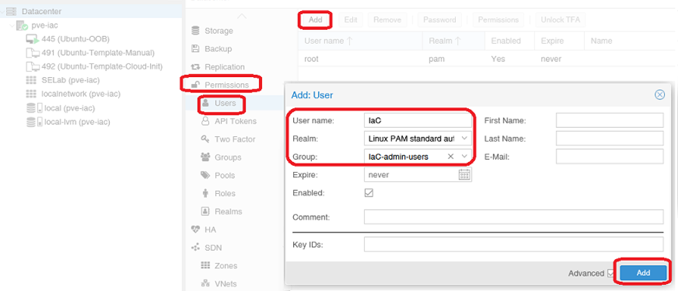
    - Click on: Datacenter/Permissions/API Tokens
        - Click: Add
            - User: IaC
            - Token ID: `Automation`
            - Privilege Separation: Unchecked
        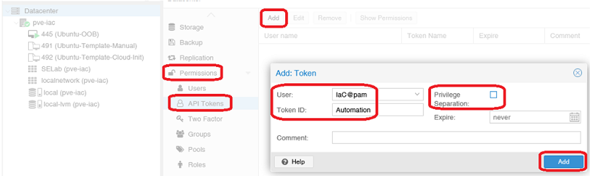
    - Copy the Token ID and Secret generated
        - **Note:** Secret value is only displayed once when token generated
        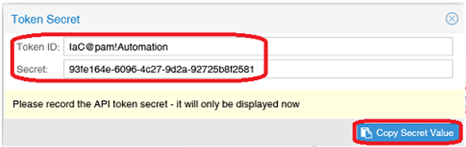
{} 

### Update Global VARS File on Ubuntu-OOB
{}

Update **global.yml** file located in **/home/fortinet/automation/ansible/vars/**
````bash
cd /home/fortinet/automation/ansible/vars
````
{}
{}
- Update **proxmox_api_token_secret:** (use Secret Value from section above)

````bash
./update_api_token_secret.sh  <Token Secret here>
````
{}

{}
- Update FortiFlex **Username/Password, Account ID and Serial Number**
    - The username/password below is not what you use to sign into Support Portal
    - It is the API's credentials that were downloaded at the beginning of this Build Step (see top of page)
````bash
./update_fortiflex_username.sh   <FortiFlex Username here>
````
````bash
./update_fortiflex_password.sh  '<FortiFlex Password here>'  <- Make sure to use single quotes
````
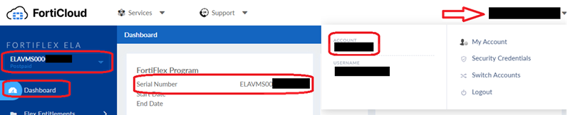
````bash
./update_fortiflex_accountID.sh  <FortiFlex Account ID here>
````
````bash
./update_fortiflex_SN.sh         <FortiFlex Serial Number here>
````
{}
{}
Update **fortinet_timezone:** US/Central <= Default Timzone **(no change needed if this is your timezone)**
````bash
./update_timezone.sh  <examples: US/Eastern, US/Mountain, US/Pacific>
````
{}

{}
Update **proxmox_api_host:** pve01		<= Default PVE Server name **(Following changes NOT needed if == pve01)**
````bash
./update_pve_server_name.sh  <Your PVE Server Name>
````
    - Also:

        - Edit file **/automation/ansible/vars/all-hosts.yml**
            -   Search for pve01 and change to your server name

        - Edit file **/automation/ansible/inventory/inventory.yml**
            -   Search for pve01 and change to your server name
{}
{}
- Update **proxmox_storage_name:** local-lvm	<= if storage on PVE, or NAS name if not
````bash
./update_storage_name.sh  <local-lvm if default, or NAS name if not>
````
- Update **proxmox_storage:** /var/lib/vz	<= if storage on PVE, or /mnt/pve/**_< NFS name >_** if using NAS
````bash
./update_VM_image_directory.sh  <directory where VM images reside>
````
{}

{}
- Update **proxmox_ubuntu_template_name:** Ubuntu-Template 
<= Name of Ubuntu template
````bash
./update_ubuntu_template_name.sh  <VM Template Name>
````
- Update **proxmox_ubuntu_template_vmid:** 491 <= VMID of Ubuntu VM Template
````bash
./update_ubuntu_template_vmid.sh  <VM Template VMID>
````
{}

{}
- **Verify**
````bash
cat global.yml
````
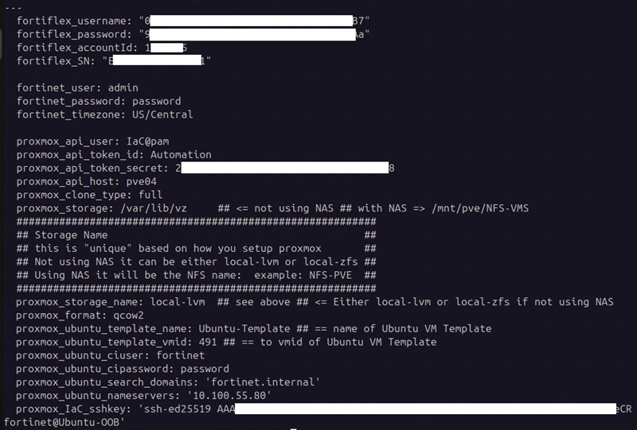
{}

### DNS
{}
All hosts and VMs can be resolved by name.
````bash
ping <your pve server name>
````
````bash
ping Ubuntu-OOB
````
{} 

### QCOW2 Files Uploaded
{}
- **qcow2** files must have the following format:

< 3 letters > dash < version > .qcow2
- FGT-v7.6.6.M.qcow2
- FMG-v7.6.6.M.qcow2
- FAZ-v7.6.6.M.qcow2

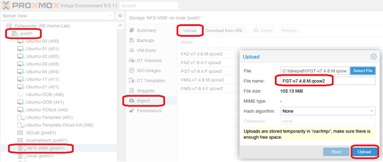
{} 
### Complete